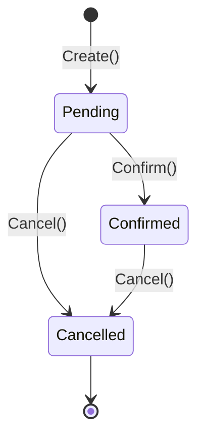
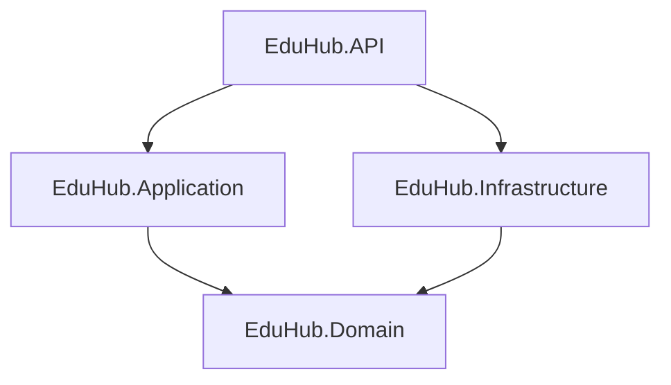

# BÀI KIỂM TRA GIỮA KỲ IN4211

- **Họ và tên:** Võ Nguyễn Đức Thiện
- **MSSV:** 0024418852
- **Học phần:** Phát triển phần mềm hướng đối tượng
- **Đề số:** 02

---

## Câu 1a. Bốn trụ cột OOP

**1. Tính đóng gói (Encapsulation)**

Là nguyên lý che giấu dữ liệu bên trong đối tượng, chỉ cho phép truy cập và thay đổi thông qua các phương thức được cung cấp.

Minh họa: `Member.cs`, `Registration.cs` sử dụng `private set` và constructor private để bảo vệ dữ liệu.

**2. Tính kế thừa (Inheritance)**

Là khả năng cho phép một lớp kế thừa thuộc tính và phương thức của lớp khác, giúp tái sử dụng mã nguồn và mở rộng chức năng.

Bài làm hiện tại chưa có lớp kế thừa trực tiếp để minh họa.

**3. Tính đa hình (Polymorphism)**

Là khả năng nhiều lớp cùng triển khai một interface nhưng có cách thực hiện khác nhau.

Minh họa:
- `EmailNotificationService.cs`
- `SmsNotificationService.cs`

Hai lớp cùng triển khai interface `INotificationService` nhưng thực hiện gửi thông báo theo cách khác nhau.

**4. Tính trừu tượng (Abstraction)**

Là nguyên lý ẩn đi các chi tiết triển khai phức tạp, chỉ cung cấp những chức năng cần thiết cho đối tượng sử dụng.

Minh họa: `IEventRepository.cs`, `INotificationService.cs`.

## Câu 1b. Đóng gói Member

Hai vấn đề của lớp Member ban đầu:

1. Các thuộc tính `Id` và `Email` sử dụng `public set`, cho phép bên ngoài thay đổi dữ liệu tùy ý.
2. Constructor public cho phép tạo đối tượng mà không kiểm tra tính hợp lệ của email.

Đã viết lại lớp Member trong project `EduHub.Domain`, sử dụng:

- `private set` để bảo vệ các thuộc tính.
- Constructor private để hạn chế khởi tạo trực tiếp.
- Factory method `Create()` để kiểm tra email không được rỗng và phải chứa ký tự `@`.

## Câu 2a. Sơ đồ trạng thái Registration



Giải thích:

- Khi tạo mới, phiếu đăng ký có trạng thái Pending.
- Chỉ phiếu Pending mới được xác nhận và chuyển sang Confirmed.
- Phiếu Pending hoặc Confirmed đều có thể hủy và chuyển sang Cancelled.
- Phiếu đã Cancelled không thể thay đổi trạng thái.

## Câu 2b. Entity Registration

Đã xây dựng enum `RegistrationStatus` gồm ba trạng thái:

- Pending: Chờ xác nhận.
- Confirmed: Đã xác nhận.
- Cancelled: Đã hủy.

Lớp Registration có các thuộc tính:

- Id
- MemberId
- EventId
- RegisteredAt
- Status

Các thuộc tính sử dụng `private set` để chỉ được thay đổi bên trong lớp.

Constructor được đặt private và sử dụng factory method static `Create(Guid memberId, Guid eventId)` để khởi tạo đối tượng.

Nếu `memberId` hoặc `eventId` bằng `Guid.Empty`, chương trình ném `ArgumentException`.

Hai phương thức nghiệp vụ:

- `Confirm()`: Chỉ cho phép chuyển từ Pending sang Confirmed.
- `Cancel()`: Cho phép chuyển từ Pending hoặc Confirmed sang Cancelled.

Nếu trạng thái hiện tại không hợp lệ, chương trình ném `InvalidOperationException`.

## Câu 2c. Unit Test Registration

Đã viết 3 unit test cho lớp Registration:

1. `Create_ShouldHavePendingStatus`: Kiểm tra phiếu đăng ký mới có trạng thái Pending.
2. `Confirm_ShouldChangeStatusToConfirmed`: Kiểm tra xác nhận thành công và chuyển trạng thái sang Confirmed.
3. `CancelThenConfirm_ShouldThrowAndRemainCancelled`: Kiểm tra sau khi hủy, gọi Confirm() sẽ ném `InvalidOperationException` và trạng thái vẫn là Cancelled.

**Kết quả:** Các unit test Registration chạy thành công.

## Câu 3a. Nguyên lý SOLID vi phạm

Lớp EventService ban đầu vi phạm ba nguyên lý SOLID:

**1. SRP – Single Responsibility Principle (Nguyên lý trách nhiệm đơn)**

- Vị trí: Dòng 6–14.
- Giải thích: Lớp vừa kiểm tra dữ liệu, thao tác cơ sở dữ liệu, ghi log và gửi thông báo. Một lớp đảm nhiệm quá nhiều trách nhiệm.

**2. OCP – Open/Closed Principle (Nguyên lý đóng/mở)**

- Vị trí: Dòng 11–14.
- Giải thích: Khi muốn thêm một kênh thông báo mới, phải sửa câu lệnh if/else hiện tại. Điều này làm cho lớp khó mở rộng mà không cần sửa mã nguồn.

**3. DIP – Dependency Inversion Principle (Nguyên lý đảo ngược phụ thuộc)**

- Vị trí: Dòng 8, 12, 14.
- Giải thích: EventService phụ thuộc trực tiếp vào các lớp triển khai cụ thể như SqlConnection, EmailSender và SmsSender thay vì phụ thuộc vào abstraction.

## Câu 3b. Refactor EventService

Đã chia các thành phần vào đúng project theo yêu cầu:

**EduHub.Domain:**
- Chứa entity Event.
- Có phương thức factory `Create()` để kiểm tra tiêu đề không rỗng và sức chứa lớn hơn 0.

**EduHub.Application:**
- Chứa interface `IEventRepository`.
- Chứa interface `INotificationService`.
- Chứa interface `INotificationFactory`.
- Chứa lớp `EventService`.

**EduHub.Infrastructure:**
- Chứa `InMemoryEventRepository` để lưu sự kiện trong bộ nhớ.
- Chứa `EmailNotificationService` để gửi thông báo email.
- Chứa `SmsNotificationService` để gửi thông báo SMS.
- Chứa `NotificationFactory` để lựa chọn kênh thông báo theo channel.

**EduHub.API:**
- Đăng ký các dịch vụ thông qua Dependency Injection trong `Program.cs`.

EventService nhận các phụ thuộc thông qua constructor, không khởi tạo trực tiếp các lớp triển khai cụ thể. NotificationFactory được sử dụng để lựa chọn kênh thông báo email hoặc SMS.

## Câu 3c. Unit Test EventService

Đã sử dụng thư viện Moq để giả lập các interface:

- `IEventRepository`
- `INotificationFactory`
- `INotificationService`

Kiểm tra khi tạo sự kiện hợp lệ:

- Phương thức `Add()` được gọi đúng một lần.
- Phương thức `Send()` được gọi đúng một lần.

**Kết quả:** Tổng cộng 5 unit test của dự án đã chạy thành công, không có test thất bại.

## Câu 4b. Git Merge và Git Rebase

**Git Merge:**

Là lệnh dùng để kết hợp các thay đổi từ hai nhánh thành một nhánh. Merge giữ lại lịch sử phân nhánh và có thể tạo một merge commit.

**Git Rebase:**

Là lệnh đưa các commit của nhánh hiện tại lên phía trên một commit khác, giúp lịch sử Git trở nên tuyến tính và dễ theo dõi hơn.

**Khi nào không nên dùng Rebase?**

Không nên dùng Rebase đối với các nhánh đã được chia sẻ và nhiều người cùng làm việc vì việc thay đổi lịch sử commit có thể gây xung đột và ảnh hưởng đến những người khác.

## Câu 5a. Sơ đồ Clean Architecture

Sơ đồ các project và chiều phụ thuộc:



Các thành phần trong từng project:

- **Domain:** Chứa entity Event.
- **Application:** Chứa IEventRepository và EventService.
- **Infrastructure:** Chứa InMemoryEventRepository.
- **API:** Chứa EventsController.

## Câu 5b. Chiều phụ thuộc

EduHub.Domain không được tham chiếu đến EduHub.Infrastructure vì Domain là lớp lõi của hệ thống, không nên phụ thuộc vào các chi tiết triển khai bên ngoài.

Nếu Domain phụ thuộc Infrastructure sẽ làm giảm tính độc lập, gây khó khăn trong việc kiểm thử, bảo trì và thay thế công nghệ.

Theo nguyên tắc Clean Architecture, các lớp bên ngoài phụ thuộc vào lớp bên trong, không làm ngược lại.

## Câu 5d. Dependency Injection và Lifetime

Nếu đăng ký `InMemoryEventRepository` bằng `AddScoped`, mỗi HTTP request sẽ nhận một instance repository mới.

Do dữ liệu được lưu trong `List<Event>` thông thường, không phải static, nên khi request POST kết thúc, instance được giải phóng. Request GET tiếp theo nhận instance mới với danh sách rỗng.

**Cách khắc phục:**

Đăng ký repository bằng `AddSingleton` để sử dụng chung một instance trong suốt vòng đời ứng dụng.

```csharp
builder.Services.AddSingleton<IEventRepository, InMemoryEventRepository>();
```

Nhờ đó, dữ liệu trong bộ nhớ được duy trì giữa các request trong thời gian ứng dụng đang chạy.
## Câu 5c. Xây dựng EventsController

Đã xây dựng EventsController trong project EduHub.API với 4 API:

| Phương thức | Endpoint | Chức năng |
|---|---|---|
| GET | /api/clubs/{clubId}/events | Lấy danh sách sự kiện của câu lạc bộ |
| GET | /api/events/{id} | Lấy thông tin sự kiện theo ID |
| POST | /api/clubs/{clubId}/events | Tạo sự kiện mới |
| DELETE | /api/events/{id} | Xóa sự kiện theo ID |

**Kết quả kiểm thử trên Swagger:**

- POST tạo sự kiện thành công: 201 Created.
- GET lấy thông tin sự kiện: 200 OK.
- DELETE xóa sự kiện thành công: 204 No Content.
- GET sau khi xóa: 404 Not Found.
- POST với dữ liệu không hợp lệ: 400 Bad Request.

Ảnh minh chứng được lưu trong thư mục MinhChung.

